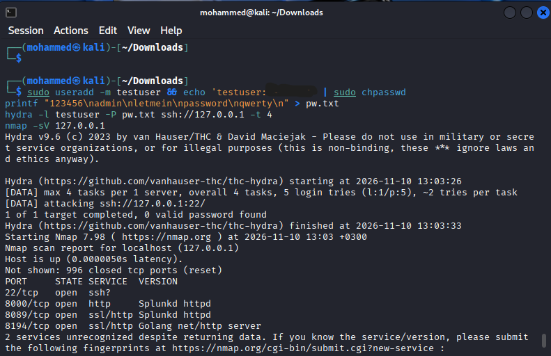
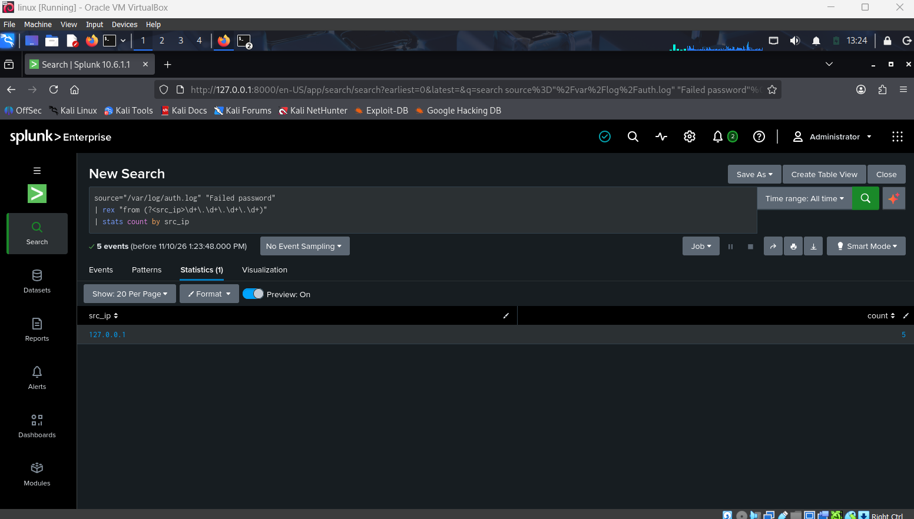
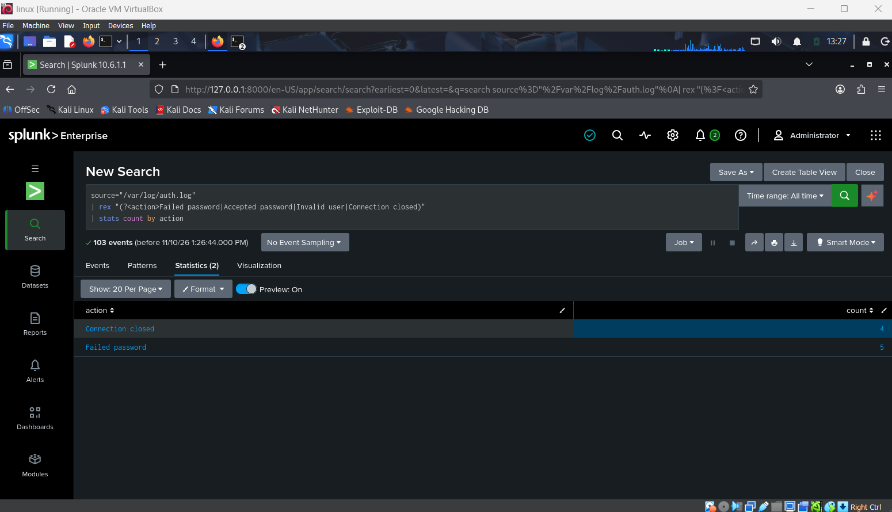
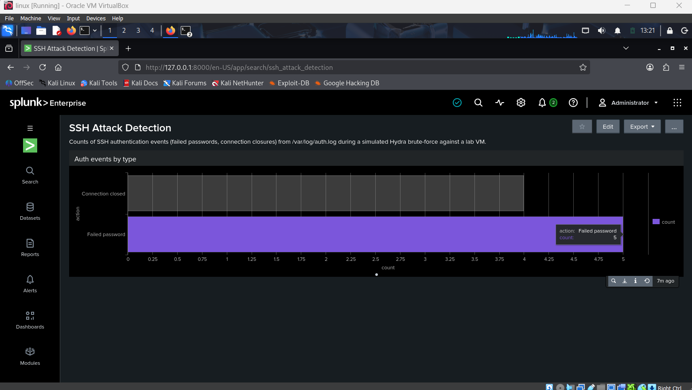

# Splunk SSH Brute-Force Detection Lab

A small blue-team lab where I ingest Linux authentication logs into **Splunk Enterprise**, simulate an SSH brute-force attack with **Hydra**, and detect it using **SPL** queries and a dashboard.

**Skills shown:** SIEM log ingestion, SPL searching, regex field extraction, dashboarding, attack simulation, MITRE ATT&CK mapping.

---

## Goal

Show the full loop of *attack, log, detect*: generate a brute-force attempt against SSH, then find clear evidence of it in Splunk.

## Environment

| Component | Details |
|---|---|
| Host | VirtualBox VM running Kali Linux |
| Network | Adapter 1: NAT (internet), Adapter 2: Host-only |
| SIEM | Splunk Enterprise 10.6 (trial license) |
| Log source | `/var/log/auth.log` via rsyslog + OpenSSH server |
| Attack tools | Hydra 9.6, Nmap 7.98 |

## Setup

1. Installed Splunk Enterprise (`.deb`) on Kali and started it with `--run-as-root` (lab only).
2. Installed and enabled `rsyslog` and `openssh-server` so SSH events are written to `/var/log/auth.log`.
3. Added `/var/log/auth.log` as a monitored input in Splunk.
4. Fixed a networking issue along the way: the NAT adapter had no IP, so I brought it up with `nmcli device connect eth0` and confirmed connectivity with `ping`.

## Attack simulation

Created a throwaway lab user and a 5-word password list, then ran Hydra against the local SSH service:

```bash
sudo useradd -m testuser
printf "123456\nadmin\nletmein\npassword\nqwerty\n" > pw.txt
hydra -l testuser -P pw.txt ssh://127.0.0.1 -t 4
```

- The correct password was not in the list, so the attack failed (`0 valid password found`), which is the expected result.
- I also ran `nmap -sV 127.0.0.1` for service discovery. It found ports 22, 8000, 8089 and 8194 open. This scan was **not** separately detected in the SSH logs.



## Detection

### 1. Failed logins by source IP

```spl
source="/var/log/auth.log" "Failed password"
| rex "from (?<src_ip>\d+\.\d+\.\d+\.\d+)"
| stats count by src_ip
```

**Result:** 5 failed attempts from one source IP, matching the 5 passwords Hydra tried.



### 2. Authentication events by type

```spl
source="/var/log/auth.log"
| rex "(?<action>Failed password|Accepted password|Invalid user|Connection closed)"
| stats count by action
```

**Result:** `Failed password` = 5, `Connection closed` = 4, and no `Accepted password`, so no login succeeded.



### 3. Dashboard

The second search is saved as a bar-chart panel on a dashboard called **SSH Attack Detection**.



## MITRE ATT&CK mapping

| Technique | ID | Evidence |
|---|---|---|
| Brute Force | [T1110](https://attack.mitre.org/techniques/T1110/) | Repeated `Failed password` events from one source IP |

## Findings

- Splunk ingested the SSH authentication events and the brute-force attempt is clearly visible as repeated failed logins.
- The count of failed logins (5) matches the number of passwords tried, which confirms the detection is accurate.
- No successful login appears, so the attack did not succeed.

## Limitations

- Attacker and target are the same VM, so the source IP is `127.0.0.1`.
- Splunk was run as root for convenience. This is not production practice.
- Only Linux SSH logs were collected, and no alert was configured, so detection is by manual search.
- The Nmap scan was not visible in SSH logs. Network-level or Windows/Sysmon telemetry would show it better.

## Next steps

- Use a separate attacker VM so the source IP is distinct.
- Add a Windows VM with Sysmon and detect Event IDs 4625 (failed logon) and 4624 (successful logon).
- Create a scheduled alert that fires on repeated failed logins from one IP.
- Run Splunk as a dedicated non-root user.
- Add a detection for port scanning (T1046) using firewall or network logs.

## What I learned

- How to get Linux logs into Splunk and extract fields with `rex`.
- How to turn raw log lines into a count-by-source detection and a dashboard.
- How to troubleshoot VM networking and Splunk startup issues.
- How to document a lab honestly, including what the detection does and does not show.
